# OpenHome

A replacement home screen for **rooted LG webOS TVs** that also puts **100+ of the TV's own
settings** - the ones LG buries, and a few it never draws at all - into one place you can reach
with the remote.

OpenHome is a fork of [OpenLauncher](https://github.com/Shantil-K/OpenLauncher) by Shantil-K, not
a different project by the same people - see [CHANGES.md](CHANGES.md) for what was added.
Developed on an **LG 65UR78003LK, webOS 10.3.2 (SDK 10.3, Chromium 120)**. Every screenshot below
is a real 3840x2160 capture off that TV, in the Editorial look it ships with.

> **It has its own package id, `io.github.devic021.openhome`**, so it installs *beside*
> OpenLauncher rather than over it - you can keep both and switch between them. Coming from
> OpenLauncher, carry your configuration across with its **Settings → Backup → Export**, then
> paste it into OpenHome's **Backup → Import**.

[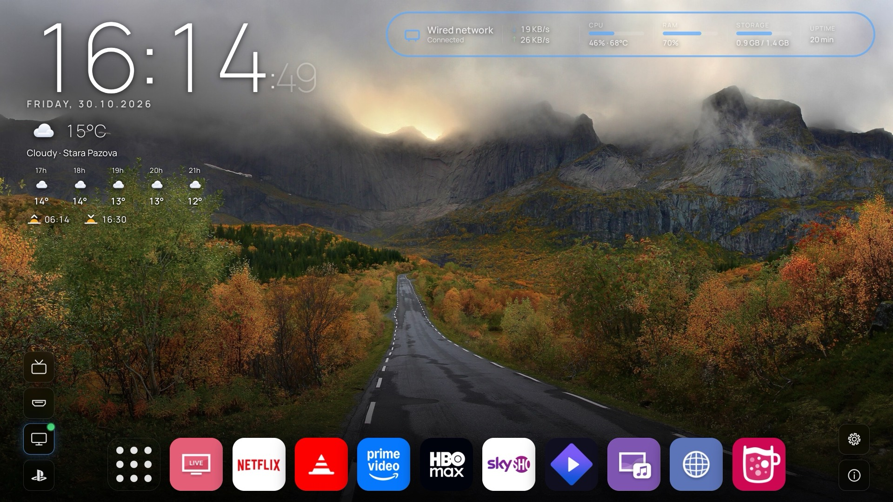](docs/screenshots/home.jpg)

<sub>Every screenshot is clickable and opens the full 3840×2160 capture.</sub>

---

## Contents

- [Why](#why)
- [The home screen](#the-home-screen)
- [TV settings](#tv-settings)
- [Launcher settings](#launcher-settings)
- [Requirements](#requirements)
- [Install](#install) - [1. Root](#1-root-the-tv) · [2. Homebrew Channel](#2-install-the-homebrew-channel) · [3. SSH](#3-get-ssh-access) · [4. The app](#4-install-the-launcher) · [5. Launch](#5-launch-it)
- [Make it the home screen](#make-it-the-home-screen)
- [Wallpapers on a USB disk](#wallpapers-on-a-usb-disk)
- [Keeping settings across a reboot](#keeping-settings-across-a-reboot)
- [Language](#language)
- [How it reads the TV](#how-it-reads-the-tv)
- [Troubleshooting](#troubleshooting)
- [Uninstall](#uninstall)
- [Credits and licence](#credits-and-licence) · [LICENSING.md](LICENSING.md) for the file-by-file detail

---

## Why

LG's own settings menu shows **36** of the **838** settings the TV actually keeps. Some of the
missing ones matter:

| Missing | What it is |
|---|---|
| **Screen Saver** | No on/off switch exists in LG's menu at all - only a standby timer you cannot disable |
| **Live Plus** | Recognises what is on screen and sends viewing data to LG. Not in the EU menu, but the setting is there and **on** |
| **HDMI Deep Colour** | Filed under a category you would never guess (`other`, dimension `gameInput`) |
| **4:4:4 Pass Through** | Per HDMI port. The difference between crisp and fuzzy text from a PC |
| **Home Promotion** | The "Sponsored" tiles on LG's own home screen |

This reads them straight out of `com.webos.settingsservice`, using **LG's own names and LG's own
descriptions**, and lets you change them.

---

## The home screen

[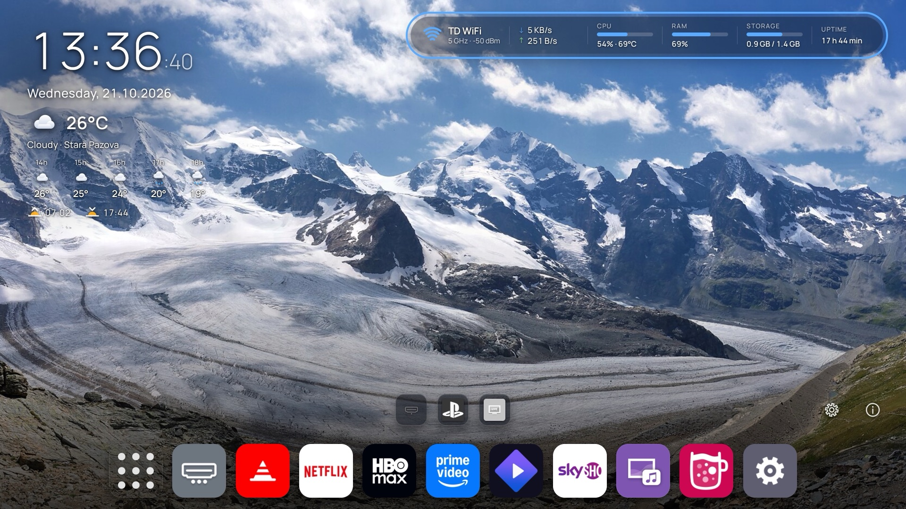](docs/screenshots/home-clean.jpg)

Clock, date, weather with an hourly strip, and sunrise/sunset. The wallpaper rotates from a pool of
photographs; an air-quality chip appears only when the air is worth mentioning.

The **status strip** along the top is live: Wi-Fi band and signal, network throughput up and down,
CPU load with panel temperature, RAM, storage and uptime.

**Input shortcuts** (the small row above the dock) show **only the inputs that have something
plugged into them** - an empty HDMI port is not listed, and appears by itself the moment you
connect something. A lit chip means the device is *awake right now*, read over HDMI-CEC, so it is
correct even while the TV is showing another input.

### Two looks

[](docs/screenshots/home.jpg)

**Editorial** is what you get out of the box. There is no bar under the app icons: they sit on the
wallpaper behind a gradient that keeps them readable. The clock is large and thin, the date spaced
small capitals. The TV's inputs stand in a column down the left edge and the settings and info
buttons in a matching one on the right, all of them the same size and resting on the same line as
the app icons.

**Classic** is the appearance the launcher had before, panels and all. Switch between them in
**Settings -> Clock -> Look**; nothing else changes.

Editorial costs about 0.8 of a percentage point of one CPU core at idle, 5.0% against 4.2%,
measured on the set it was built on.

### All apps

[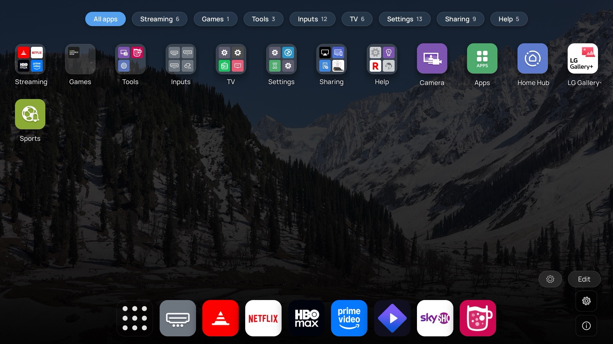](docs/screenshots/apps.jpg)

Folders you make yourself, plus the TV's own groups (Inputs, TV, Settings, Sharing, Help) picked up
automatically. Apps can be pinned to the dock, hidden, renamed and reordered.

### Weather

[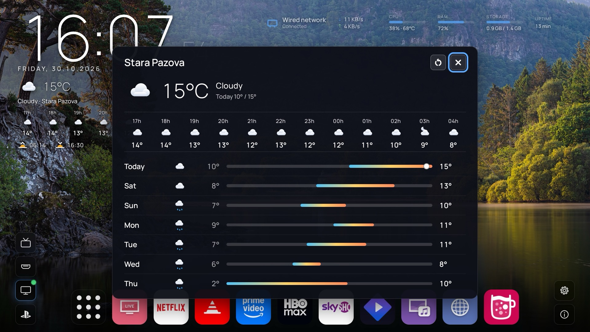](docs/screenshots/forecast.jpg)

Press OK on the weather block for seven days, today's range, and the hour-by-hour strip.
Data is [Open-Meteo](https://open-meteo.com) - no key and no account.

**The location sets itself.** On a first run the launcher reads the TV's own time zone, which
carries a city and a country code - `Europe/Belgrade` gives Belgrade, RS - and looks that up. No
geolocation service, no IP lookup, and nothing you did not already tell the television. Change it
in **Settings → Weather → Location**; once you do, it is never touched again.

### System panel

[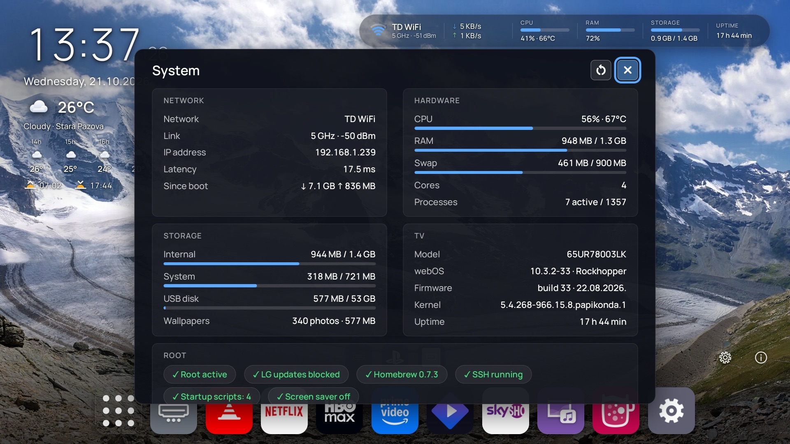](docs/screenshots/system.jpg)

Press OK on the status strip. Network link with **latency** and traffic since boot, CPU with panel
temperature, RAM and swap, storage across internal/system/USB, and the TV's model, firmware and
kernel.

The bottom row is the one worth watching: **root active · LG updates blocked · Homebrew Channel ·
SSH running · startup scripts · screen saver off**. Those are exactly the things a firmware boot
can quietly undo.

---

## TV settings

Thirteen tabs, reached from **Settings → TV → Open**.

Controls are **not hard-coded**. For every key the TV is asked whether it is a range or a list, and
which values are valid *right now* - so Aspect Ratio drops the options this panel does not support,
and nothing goes stale after a firmware update.

### Privacy

[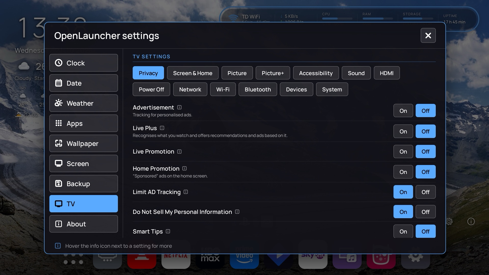](docs/screenshots/tv-privacy.jpg)

Advertisement tracking, **Live Plus**, Live Promotion, **Home Promotion** ("Sponsored" tiles),
Limit AD Tracking, Do Not Sell My Personal Information, Smart Tips and Content Recommendation -
nine switches, most of which the EU menu does not show.

### Screen & Home

[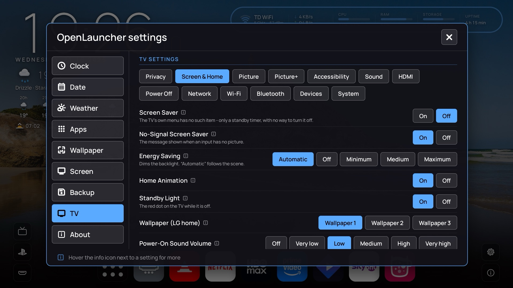](docs/screenshots/tv-screen.jpg)

**Screen Saver** - the one LG's menu has no item for. Also the no-signal screen saver, Energy
Saving (backlight dimming), home animation, the standby light on the front of the set, LG's own
wallpaper, and the power-on sound volume.

### Picture

[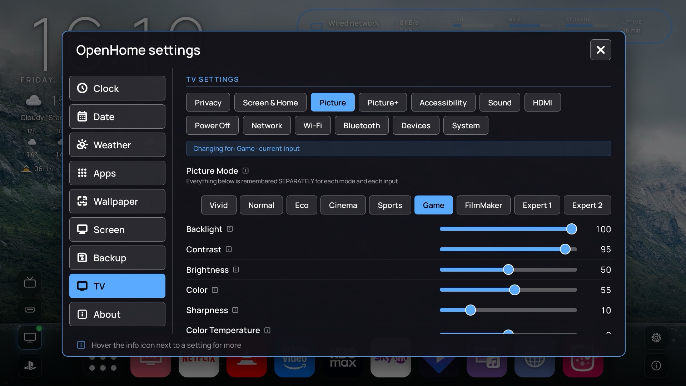](docs/screenshots/tv-picture.jpg)

Picture Mode, Backlight, Contrast, Brightness, Colour, Sharpness, Colour Temperature and Gamma.

The header says **what you are editing** - "Changing for: Cinema · current input". Picture settings
are stored *per picture mode and per input*, so the same slider has nine or more separate values on
one TV. The pane tells you which one it is writing.

### Picture+

[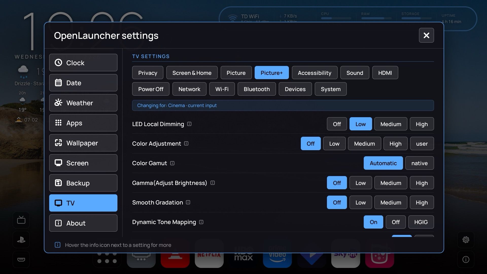](docs/screenshots/tv-picture-plus.jpg)

LED Local Dimming, Colour Adjustment, Colour Gamut, Smooth Gradation, Dynamic Tone Mapping and the
rest of the advanced panel controls.

### Accessibility

[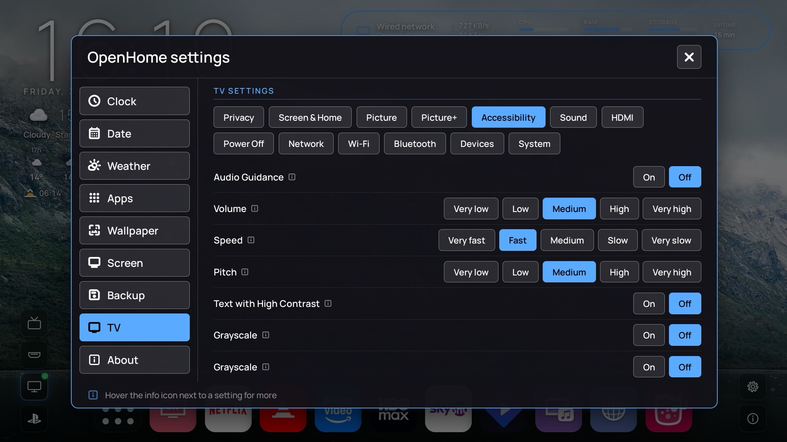](docs/screenshots/tv-accessibility.jpg)

Audio Guidance with its volume, speed and pitch, high-contrast text, and greyscale.

### Sound

[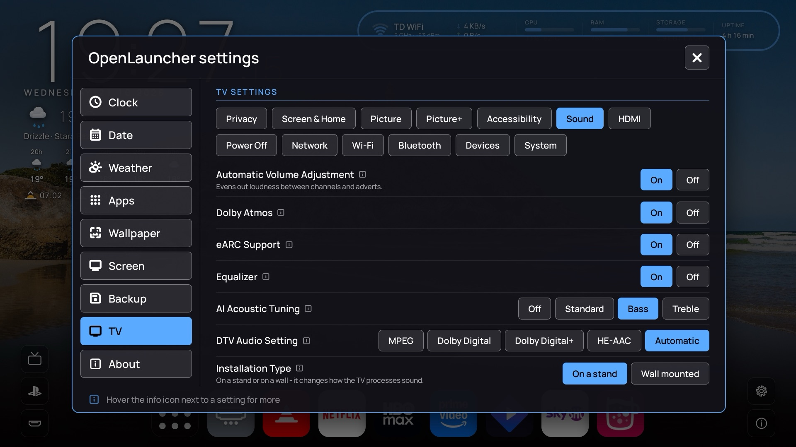](docs/screenshots/tv-sound.jpg)

Automatic Volume Adjustment, **Dolby Atmos**, eARC support, equalizer, AI Acoustic Tuning, the
digital audio format (MPEG / Dolby Digital / Dolby Digital+ / HE-AAC / Automatic), and installation
type - stand or wall, which changes how the TV processes sound.

### HDMI

[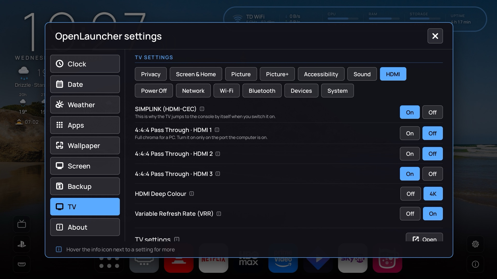](docs/screenshots/tv-hdmi.jpg)

**SIMPLINK (HDMI-CEC)** - this is why the TV jumps to the console by itself when you switch it on.
**4:4:4 Pass Through per port**, so you can turn full chroma on only for the port the PC is on.
**HDMI Deep Colour** and **Variable Refresh Rate**.

### Power Off

[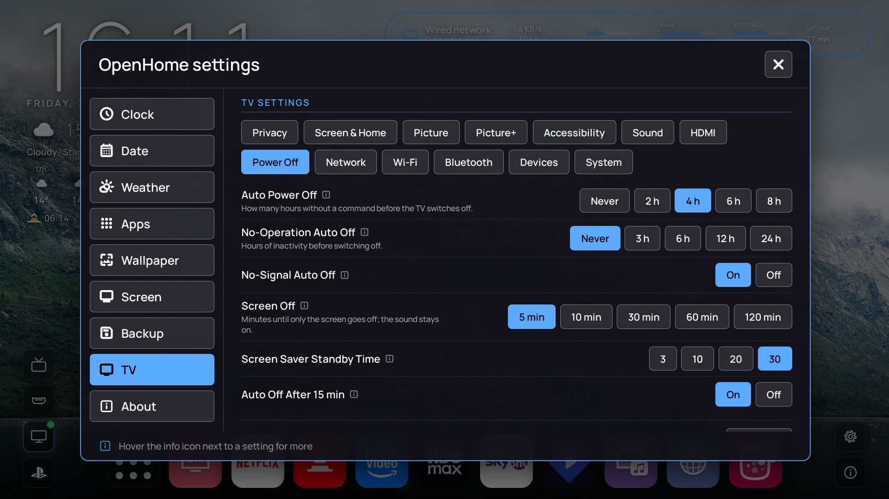](docs/screenshots/tv-power.jpg)

Auto Power Off, no-operation auto off, no-signal auto off, Screen Off (picture off while the sound
keeps playing) and the screen-saver standby time.

### Network

[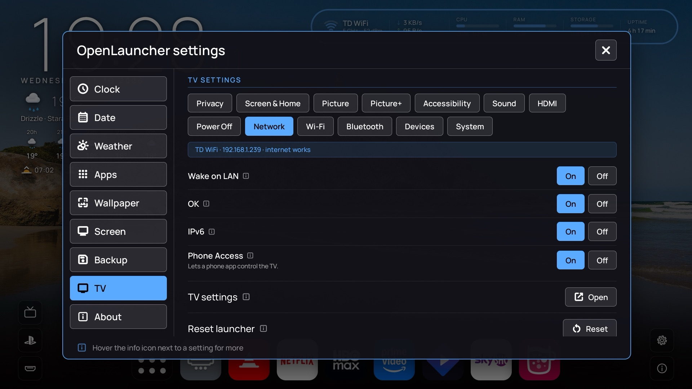](docs/screenshots/tv-network.jpg)

The live link with its address and whether the internet actually works, Wake on LAN, IPv6, and
Phone Access.

### Wi-Fi

[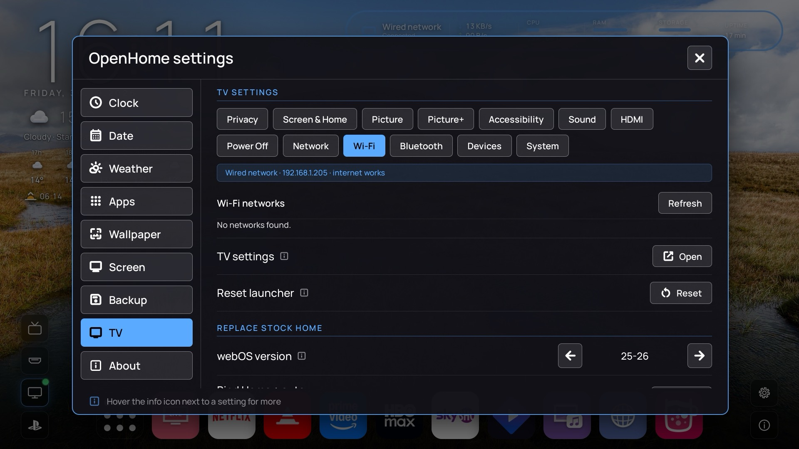](docs/screenshots/tv-wifi.jpg)

Scans and lists networks with their security type and signal strength, connects with a password,
and forgets saved networks.

### Bluetooth

[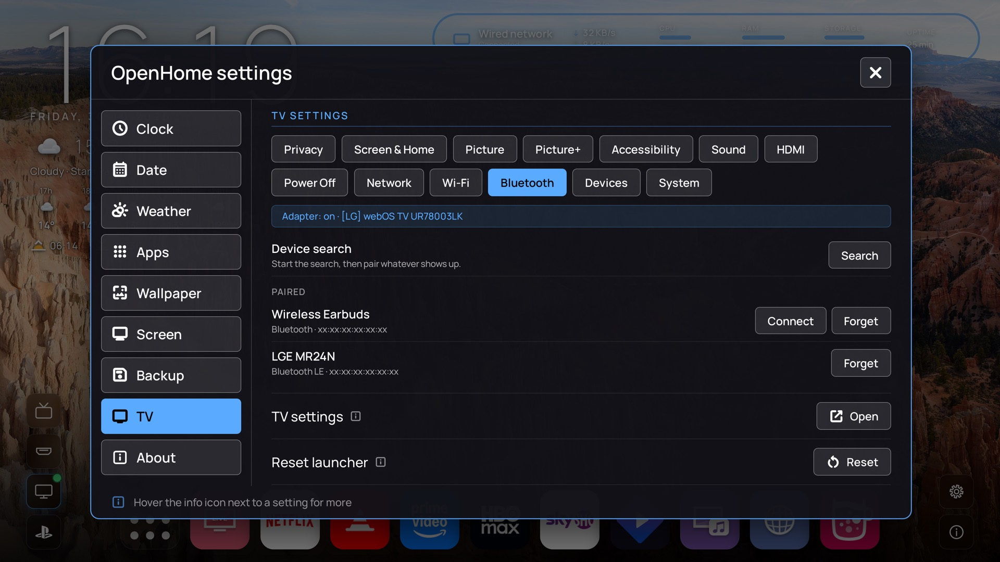](docs/screenshots/tv-bluetooth.jpg)

Starts a search, lists what is nearby with its type and address, pairs, connects and forgets.
Paired devices are listed separately from the ones merely in range.

### Devices

[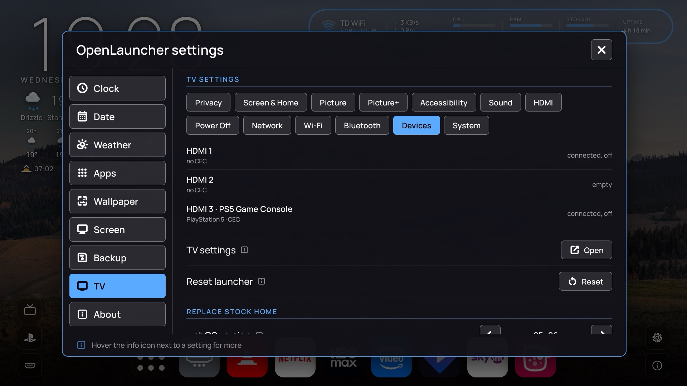](docs/screenshots/tv-devices.jpg)

What is on each HDMI port, whether it speaks CEC, and whether it is **connected, off** or awake.
A device that announces itself gets its real name - a PlayStation 5 is listed as one.

### System

[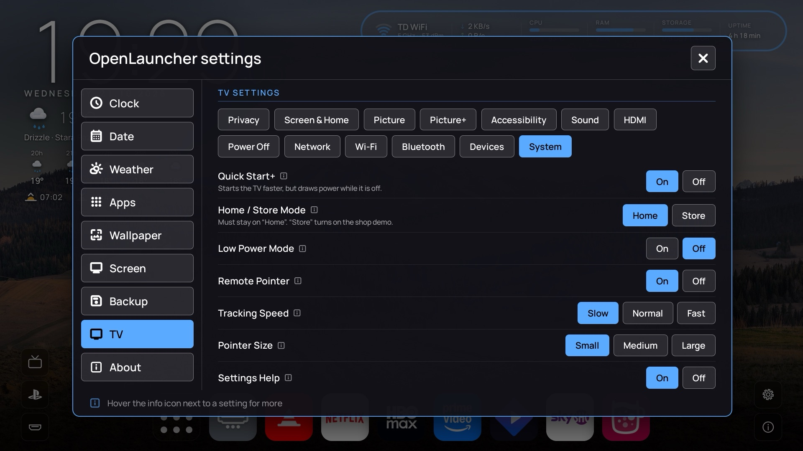](docs/screenshots/tv-system.jpg)

Quick Start+, **Home / Store Mode** (leave it on Home - Store turns on the shop demo), Low Power
Mode, the remote pointer with its speed and size, and Simple Mode.

---

## Launcher settings

[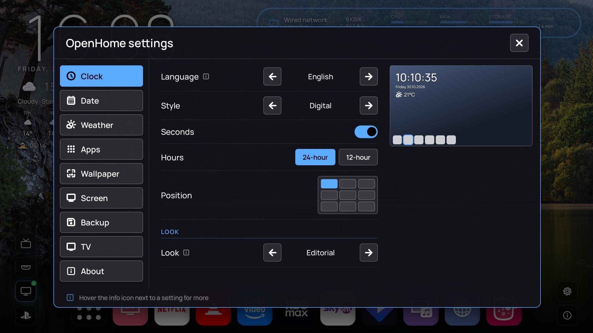](docs/screenshots/settings-clock.jpg)

Nine tabs of the launcher's own options - Clock, Date, Weather, Apps, Wallpaper, Screen, Backup, TV
and About. Every setting has a hint behind the info icon next to it.

**Backup** exports the whole configuration as text you can paste back, and writes it to a file when
root is available.

---

## Requirements

| | |
|---|---|
| **A rooted LG TV** | webOS 4 and up. Developed on webOS 10.3 (badged 25) |
| **[Homebrew Channel](https://github.com/webosbrew/webos-homebrew-channel)** | 0.7.x, with the root service enabled |
| **SSH access** | For the home replacement and the startup scripts |
| **A USB disk** | Optional, for the wallpaper pool |

Without root the launcher still runs as an ordinary app, but **TV settings, the system panel and
the home replacement all need the root service** - they go through
`org.webosbrew.hbchannel.service/exec`.

> **At your own risk.** Rooting can void your warranty, and a firmware update can remove root and
> undo the home replacement.

---

## Install

### 1. Root the TV

Which method depends on your webOS version. Start at **[webosbrew.org/root](https://www.webosbrew.org/)**,
which asks for your model and firmware and sends you to the right one.

This project was developed on a TV rooted with **[slopbro](https://github.com/throwaway96/slopbro)**
(webOS 23-25, including 10.x). Another current route is
**[e.nya.je/getroot](https://e.nya.je/getroot/)**.

Check it worked - the Homebrew Channel should show **root: true** on its own home page.

### 2. Install the Homebrew Channel

If the root method did not already install it, get the `.ipk` from
[webosbrew/webos-homebrew-channel/releases](https://github.com/webosbrew/webos-homebrew-channel/releases)
and install it. Then open it and turn on:

- **Root service** - everything here depends on it
- **SSH server** - needed for steps 3 and onward
- **Block OTA updates** - optional, but a firmware update removes root

### 3. Get SSH access

The Homebrew Channel generates its own SSH key. On the TV open
**Homebrew Channel → Settings → Key Server**, start it, then on your computer:

```bash
# the TV shows the command and a one-time code on screen
curl -s http://<tv-ip>:9991/webos_rsa > ~/.ssh/lgtv
chmod 600 ~/.ssh/lgtv
ssh -i ~/.ssh/lgtv root@<tv-ip>
```

Stop the key server afterwards. Find `<tv-ip>` in **Settings → Network**, or in this launcher's own
Network tab once it is running.

### 4. Install the launcher

Three ways, easiest first.

#### a. From a release - nothing to build

Download `io.github.devic021.openhome_*.ipk` from
[Releases](https://github.com/devic021/openhome-webos/releases), put it on a USB stick, and on the
TV use **Homebrew Channel → App Manager → Install from file**.

No Node, no webOS CLI, no SSH. Every release is built and attached automatically.

#### b. With the webOS CLI - if you want to build it yourself

```bash
git clone https://github.com/devic021/openhome-webos.git
cd openhome-webos
npm install -g @webos-tools/cli
ares-setup-device --add tv --info "host=<tv-ip>" --info "port=9922" --info "username=prisoner"
ares-package src -o /tmp --no-minify
ares-install --device tv /tmp/io.github.devic021.openhome_*.ipk
```

Needs Developer Mode on the TV.

#### c. Over SSH - for working on it

The launcher is plain HTML, CSS and JavaScript with no build step, so files can be copied straight
into place. This only works once the app is installed by (a) or (b), because copying files does
not register an app with the TV.

```bash
TV=<tv-ip> ./deploy.sh all
```

`deploy.sh` checks every JavaScript file with `node --check` before sending anything - a file that
does not parse leaves a blank home screen, recoverable only over SSH - then reloads the page.

> **Coming:** OpenHome has been submitted to the
> [Homebrew Channel's app repository](https://github.com/webosbrew/apps-repo). Once it is merged,
> it installs from the Homebrew Channel on the TV itself, with no computer involved at all.

### 5. Launch it

```bash
ssh -i ~/.ssh/lgtv root@<tv-ip> \
  "luna-send -n 1 -f luna://com.webos.service.applicationManager/launch \
   '{\"id\":\"io.github.devic021.openhome\"}' < /dev/null"
```

Or just find it in the TV's app list.

> **`< /dev/null` is not decoration.** `luna-send` performs the call but prints *nothing at all*
> when its stdin is a pipe or a heredoc instead of a terminal. Every example here and every script
> in `scripts/` includes it for that reason.

---

## Make it the home screen

```bash
./scripts/install-home.sh <tv-ip>          # and --undo puts the stock home back
```

That copies two startup scripts to the TV and runs them, so the Home button works straight away
and power-on works from the next cold boot. Scripts in `/var/lib/webosbrew/init.d/` are run by the
Homebrew Channel at every boot, in alphabetical order.

Two scripts are needed, and only together.

### Why two

The Home **button** and switching the TV **on** take completely different paths:

```
HOME KEY   ->  sam    ->  launchDefaultApp    ->  reads the home-app setting
POWER ON   ->  bootd  ->  com.webos.app.home  ->  compiled in, ignores the setting
```

`replace.sh` sets the home-app setting, which covers the button. But `bootd` has
`com.webos.app.home` built into it - confirmed with `strings /usr/sbin/bootd` - so no setting can
ever redirect a power-on.

`homestub.sh` solves that differently: it bind-mounts a tiny, invisible web app over
`/usr/palm/applications/com.webos.app.home`. That app does one thing - launch this launcher and
close itself. Anything that asks for the stock home, `bootd` included, now gets this one.

It also points the TV's "last input" at the launcher and turns **Home Auto Launch off**, because
the mount only takes effect once the startup scripts have run - roughly a minute into a cold boot -
and with Home Auto Launch on, webOS opens LG's home before that happens.

**The trade-off:** webOS's boot animation no longer plays.

The three settings it changes are saved to `/var/lib/webosbrew/openlauncher-boot.orig` the first
time it runs, so they can be put back.

---

## Wallpapers on a USB disk

The launcher can keep a pool of photographs on a USB disk and rotate through them. A 4K photograph
is about 1.5 MB against 2.7 GB an hour for streamed video, and it works with the internet down.

1. Format a stick and **label it `OPENHOME`** - that is how the script finds it, so nothing has
   to be edited:

   ```bash
   sudo mkfs.ext4 -L OPENHOME /dev/sdX1      # ext4 keeps permissions; exfat: mkfs.exfat -n OPENHOME
   ```

2. Install the mount script:

   ```bash
   scp -i ~/.ssh/lgtv scripts/wallpapers.sh root@<tv-ip>:/var/lib/webosbrew/init.d/
   ssh -i ~/.ssh/lgtv root@<tv-ip> 'chmod +x /var/lib/webosbrew/init.d/wallpapers.sh'
   ```

   To pin it to one specific disk instead of any disk with that label, set `UUID` at the top of
   the script and it wins over the label.

3. In the launcher: **Settings → Wallpaper → Source → Photos**, then **Refresh the pool**. It
   downloads from [Wikimedia Commons](https://commons.wikimedia.org) at 3840 px in the background.

### Your own pictures

Copy them onto the same disk, in the top folder, as `.jpg`, `.png` or `.webp`. They are mounted at
`/media/developer/wallpapers` on the TV, so with the disk in a computer it is just the root of the
stick, and without one `scp` to that folder does as well.

**Settings → Wallpaper → Which photos** then says what the rotation uses:

| | |
|---|---|
| **Mine and Commons** | your pictures and the downloaded pool together, the default |
| **Only mine** | nothing but your own files, and no downloading at all |
| **Only Commons** | the downloaded pool, as before |

Pictures copied on while the launcher is running are picked up by **Rescan** in the same place, or
at the next start. Nothing of yours is ever deleted: the pool only ever removes files it
downloaded itself, which is why it goes by the manifest it writes rather than by what is on the
disk.

A 4K photograph should be at least 3840 px wide. The screen is painted at devicePixelRatio 2, so a
1920 px picture is upscaled twice over and looks soft.

### Downloads the launcher had lost track of

The pool keeps a manifest of what it has fetched, and only what the manifest names was ever shown
or tidied up. Anything that fell out of it stayed on the disk, unusable and unnoticed: the set
this was written on held **606 pictures against 200 in the manifest**, 0.68 GB of 4K photographs
that nothing referred to any more.

They are taken back rather than deleted. At startup every file in the folder shaped like one of
our downloads but missing from the manifest is added back to it, labelled with the day it was
downloaded, which its own file name carries. **Settings → Wallpaper → Pictures to keep** is raised
to make room for them, because otherwise the next download would delete the ones just recovered.

From then on they are pruned and refreshed like any other, so the folder holds a steady number
instead of gaining a generation every time the manifest is reset.

**Mounted by UUID on purpose.** webOS re-enumerates USB disks across a reboot, so a stick that was
`/dev/sda3` one day is `/dev/sdb3` the next. Anything that names the device fails with
`Input/output error`, which looks exactly like a corrupt disk and is not.

### The offline wallpaper

**Settings → Wallpaper → Source → Offline** plays `src/access/wallpaper/loop.mp4`, a 4K video
built from the photographs bundled beside it. The TV decodes it in hardware, so it costs far less
than painting 4K stills from the CPU.

That file is **generated, not committed**. Build it before packaging if you want it:

```bash
SECS=20 bash scripts/make-wallpaper-video.sh     # one still per photo, 20s each
```

Without it the offline source still works - the launcher falls back to showing the same
photographs as stills. The video is an optimisation, not a requirement.

If the disk is absent the folder stays empty and the launcher falls back to its online list by
itself, so a missing stick is not an error.

---

## Keeping settings across a reboot

On some sets a changed system setting does not survive a power cycle. `tweaks.sh` re-applies the
ones you chose at every boot:

```bash
scp -i ~/.ssh/lgtv scripts/tweaks.sh root@<tv-ip>:/var/lib/webosbrew/init.d/
ssh -i ~/.ssh/lgtv root@<tv-ip> 'chmod +x /var/lib/webosbrew/init.d/tweaks.sh'
```

It reads `/var/lib/webosbrew/openlauncher-tvsettings.json`, which the TV settings pane writes -
one JSON object per line:

```json
{"c":"general","k":"adCookie","v":"off"}
```

Delete a line to forget one setting; delete the file to let LG's defaults come back.

---

## Language

**English and Serbian**, switched in **Settings → Clock → Language**. *Automatic* follows the TV's
own interface language, so a Serbian TV gets Serbian without anyone choosing anything.

Adding a language is one table in `src/js/i18n.js` and one line in `I18N_LANGUAGES`. Strings are
keyed by their **English text**, so a missing translation falls back to readable English rather
than a blank or a key name.

Two things are easy to miss when translating:

- `index.html` is written in English and marked up with `data-i18n`, `data-i18n-title` and
  `data-i18n-placeholder`, which `i18n.js` translates after the document loads.
- One string is drawn by **CSS generated content** (`#folderbar::before`), where `t()` cannot
  reach. It comes from a custom property that `i18n.js` sets instead.

The TV-settings half of the Serbian table is **not a translation at all** - both halves are LG's
own wording, lifted from the settings app and its locale files, so the labels match what LG's own
menu says.

---

## How it reads the TV

Everything goes through the TV's own public Luna services. Nothing patches firmware.

| | |
|---|---|
| Settings | `com.webos.settingsservice` - `getSystemSettings`, `getSystemSettingDesc`, `setSystemSettings` |
| Apps | `com.webos.applicationManager` |
| Inputs | `com.webos.service.eim` |
| Wi-Fi | `com.webos.service.wifi` |
| Bluetooth | `com.webos.service.bluetooth2` |
| Shell commands | `org.webosbrew.hbchannel.service/exec` |

**Dimensions.** Picture and sound settings are stored per picture mode × input. Pass **no**
`dimension` and the service resolves the current context itself and tells you which one it used.
Pass a field it does not expect and it answers *"no result from DB"* - which is why the panes send
nothing and read the answer instead.

**Descriptions.** `getSystemSettingDesc` returns each key's type, its valid values and its current
validity. That is what makes the controls adapt to the model instead of being hard-coded.

**The full key list** - all 838 of them, with what each accepts and LG's own name for it - is in
[docs/tv-settings.md](docs/tv-settings.md), along with how it was extracted. Useful if you want to
expose a setting this launcher does not.

---

## Troubleshooting

**The home screen is blank after an update.**
A JavaScript file that does not parse leaves an empty page, and the only way back is SSH. The
`deploy.sh` in this repo runs `node --check` on every file *before* it sends anything, for exactly
this reason.

**The Home button works but switching the TV on shows LG's home.**
`homestub.sh` is missing or did not run. Check it:
```bash
ssh -i ~/.ssh/lgtv root@<tv-ip> 'mount | grep com.webos.app.home'
```

**Wallpapers stopped and the built-in loop is playing.**
The launcher falls back after six failed image loads. Check the disk is mounted:
```bash
ssh -i ~/.ssh/lgtv root@<tv-ip> 'mount | grep wallpapers; ls /media/developer/wallpapers | wc -l'
```

**The TV settings tab is empty.**
The root service is not reachable. Open the Homebrew Channel and confirm the root service is
running.

**A setting goes back after a reboot.**
That is the set, not the launcher - see [Keeping settings across a reboot](#keeping-settings-across-a-reboot).

---

## Uninstall

Put the stock home back **first** - uninstalling on its own leaves Home pointing at an app that
is no longer there:

```bash
./scripts/install-home.sh <tv-ip> --undo
```

By hand instead:

```bash
ssh -i ~/.ssh/lgtv root@<tv-ip> '
  umount /usr/palm/applications/com.webos.app.home
  rm -f /var/lib/webosbrew/init.d/homestub.sh /var/lib/webosbrew/init.d/replace.sh
  luna-send -n 1 -f luna://com.webos.service.applicationmanager/setDefaultApp \
    "{\"category\":\"home\",\"appId\":\"com.webos.app.home\"}" < /dev/null
'
```

`install-home.sh --undo` also puts back the three boot settings that `homestub.sh` changed, from
the copy it saved in `/var/lib/webosbrew/openlauncher-boot.orig` the first time it ran. Then remove
the app from the TV's own app manager or from the Homebrew Channel's App Manager.

The launcher's own **Settings → About → Uninstall** does all of this for you.

---

## Credits and licence

Built on **[OpenLauncher](https://github.com/Shantil-K/OpenLauncher)** by Shantil-K, which is
itself based on **QwQHome** by **exkc**. All credit for the original design and implementation
goes to exkc.

The project as a whole is distributed under **GPL-3.0-or-later** ([LICENSE](LICENSE)), following
upstream. The parts do **not** all share one licence: code written for this project is
GPL-3.0-or-later, code inherited from QwQHome keeps its original WTFNMFPL headers, and the icons,
fonts and bundled photographs are Apache-2.0, OFL-1.1 and CC-BY-SA respectively.

**[LICENSING.md](LICENSING.md) lists exactly what applies to which file.**
[CHANGES.md](CHANGES.md) records what was changed, as the GPL asks.

- Root: [Homebrew Channel](https://github.com/webosbrew/webos-homebrew-channel) ·
  [slopbro](https://github.com/throwaway96/slopbro) · [webosbrew.org](https://www.webosbrew.org/)
- Weather: [Open-Meteo](https://open-meteo.com) (CC BY 4.0)
- Wallpaper pool: [Wikimedia Commons](https://commons.wikimedia.org)
- Icons: [Material Symbols](https://github.com/google/material-design-icons) by Google (Apache-2.0)
- Type: [Plus Jakarta Sans](https://github.com/tokotype/PlusJakartaSans) and
  [Manrope](https://github.com/sharanda/manrope), both OFL-1.1

Not affiliated with LG. Everything here talks to the TV's own public services and does not patch
firmware. A firmware update can remove root and undo the home replacement.
